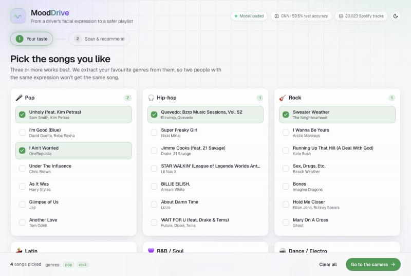
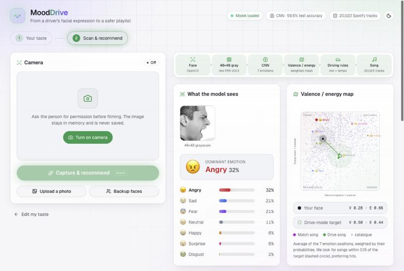
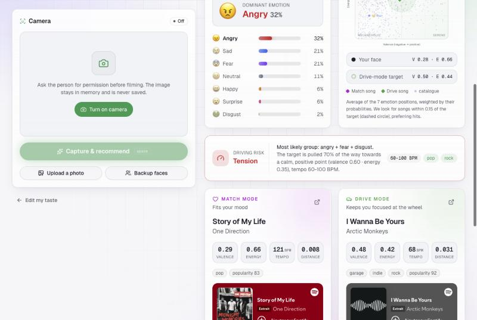

# Mood-Based Song Recommender

From a driver's facial expression to a safer playlist.

## Présentation du projet

### L'idée

Écouter de la musique est l'une des activités les plus courantes en voiture, et la musique agit sur nos émotions. Nous sommes partis d'une question simple : **si une voiture peut lire l'expression du conducteur, peut-elle choisir une musique qui lui plaît tout en l'aidant à conduire plus calmement ?**

Notre projet relie donc un visage à une chanson :

```
photo du visage → classifieur → 7 probabilités d'émotion → point (valence, énergie) → chansons les plus proches → filtrées par les goûts et par des règles de conduite
```

### Les données

Nous avons utilisé deux jeux de données qui n'ont **aucune colonne en commun** :

| Jeu de données | Contenu | Ce qu'on en fait |
|---|---|---|
| [Spotify Tracks Dataset](https://www.kaggle.com/datasets/maharshipandya/-spotify-tracks-dataset) (Kaggle) | 114 000 lignes, une par couple (chanson, genre), avec des mesures calculées par Spotify : `valence` (triste → joyeux), `energy` (calme → intense), `tempo`, `popularity`… | Le côté musique : chaque chanson devient un point sur une carte émotionnelle |
| [FER-2013](https://www.kaggle.com/datasets/msambare/fer2013) (Kaggle) | 35 887 visages en niveaux de gris, 48×48 pixels, classés en 7 émotions | Le côté visage : nous avons entraîné un classifieur dessus |

**Le pont entre les deux** est le modèle circomplexe de Russell, utilisé en psychologie : une émotion se place sur deux axes, la valence (négatif ↔ positif) et l'activation (calme ↔ excité). Spotify donne déjà à chaque chanson une `valence` et une `energy` entre 0 et 1. Nous avons placé nous-mêmes les 7 émotions sur cette carte (par exemple la joie en (0,85 ; 0,70), la colère en (0,20 ; 0,90), la tristesse en (0,15 ; 0,25)). Un visage n'est jamais à 100 % une seule émotion : nous prenons donc la **moyenne des 7 positions, pondérée par les probabilités** du classifieur.

**Nettoyage des données Spotify.** Le fichier brut répète une chanson autant de fois qu'elle a de genres. Nous avons supprimé les valeurs manquantes, fusionné les genres pour garder une ligne par chanson, supprimé les doublons (même titre et mêmes artistes), les pistes sans tempo détecté et les contenus qui ne sont pas de la musique. Il reste **79 281 chansons** sur 114 000 lignes.

**Une découverte en explorant les données.** Le dataset contient des genres qui portent des noms d'humeur (`happy`, `sad`, `chill`, `party`). Nous pensions pouvoir les utiliser comme étiquettes, mais le genre `happy` a en fait une valence **basse** et une énergie très haute : c'est du « happy hardcore », une musique électronique rapide. Les noms de genres ne sont donc pas fiables, et nous avons préféré nous appuyer sur les mesures `valence` et `energy` de chaque chanson.

### Le classifieur d'émotions

Entraîné sur Google Colab avec un GPU (`train_emotion_classifier.ipynb`) :

| Modèle | Précision sur les images de test |
|---|---|
| Régression logistique (référence, pixel par pixel) | 35,7 % |
| **Réseau de neurones convolutif (CNN)** | **59,5 %** |

Le hasard donnerait environ 14 % (7 classes). Le CNN reconnaît bien la joie (86 %) et la surprise, mal la peur, et presque jamais le dégoût, qui n'a que très peu d'images d'entraînement. Nous avons utilisé l'augmentation de données (rotations, zooms, miroirs) et l'arrêt anticipé pour limiter le sur-apprentissage. La matrice de confusion et les courbes d'apprentissage sont dans `training_outputs/`.

### Le mode « Drive »

Mettre une musique énervée à un conducteur énervé n'est pas une bonne idée. Des études sur simulateur (Brodsky, 2001) montrent qu'une musique rapide va avec une vitesse plus élevée et plus d'infractions. Nous avons donc ajouté deux modes :

- **Match** : une chanson qui correspond à l'humeur ;
- **Drive** : on détecte d'abord un risque, puis on déplace la cible musicale à 70 % vers un état plus sûr et on limite le tempo (principe « iso » de la musicothérapie : partir de l'état de la personne et l'amener progressivement ailleurs).

| Risque détecté | Émotions additionnées | Musique visée |
|---|---|---|
| Tension | colère + peur + dégoût | plus calme et positive, 60-100 BPM |
| Excitation | joie + surprise | énergie limitée à 0,60, moins de 120 BPM |
| Vigilance basse | tristesse | plus positive, tempo moyen 85-110 BPM |
| Aucun | neutre | inchangée, moins de 120 BPM |

Sur 400 visages tirés au hasard, pour les visages tendus, le tempo moyen passe de 122 BPM (mode Match) à 80 BPM (mode Drive), et l'énergie de 0,67 à 0,44.

**Goûts personnels.** Deux personnes avec la même expression ne doivent pas recevoir la même chanson. L'utilisateur coche quelques titres qu'il aime, nous en déduisons ses genres préférés, et les recommandations restent dans ces genres.

### L'interface : MoodDrive

Pour la démonstration, nous avons fait une application web locale (FastAPI + React) qui utilise la webcam en direct. On choisit d'abord quelques chansons qu'on aime :



Puis on capture son visage. L'interface montre ce que voit le modèle (visage 48×48 en gris), les 7 probabilités, et la position du visage sur la carte valence/énergie, avec la flèche vers la cible du mode Drive :



Enfin, elle affiche le risque détecté et la règle appliquée, une chanson **Match** et une chanson **Drive**, avec le lecteur Spotify :



### Limites

- Une expression du visage n'est pas forcément l'émotion ressentie, et les images FER-2013 sont petites et parfois mal étiquetées.
- FER-2013 n'a pas de classe « somnolent » : le risque le plus important au volant, la fatigue, est seulement approché par la tristesse.
- Les coordonnées des émotions, les seuils et les tempos sont nos propres choix, pas des valeurs mesurées.
- Nous montrons que le lien visage → musique est faisable, pas qu'il réduit les accidents.
- Lire les émotions sur un visage est un traitement de données biométriques : un vrai produit demanderait le consentement explicite et un traitement sur l'appareil (dans notre démo, l'image n'est jamais enregistrée).

### Dans quel ordre lire le projet

1. `mood_recommender.ipynb` : le notebook principal (chargement, nettoyage, logique, visualisations, conclusion). Il s'exécute en quelques secondes.
2. `train_emotion_classifier.ipynb` : l'entraînement du classifieur.
3. `mood-song-app/` ou `live_demo.ipynb` : la démonstration en direct.

## Contents

- `mood_recommender.ipynb`: main notebook (6 sections). Runs in a few seconds, no GPU needed.
- `train_emotion_classifier.ipynb`: trains the emotion classifier on Google Colab (GPU) and exports `predictions_test.csv`.
- `data/spotify_tracks.csv`: Spotify Tracks Dataset, as downloaded from Kaggle (114,000 rows).
- `data/predictions_test.csv`: classifier output on the 7,178 FER-2013 test images.
- `data/sample_faces/`: 21 FER-2013 test images used for the illustrations.
- `training_outputs/`: scores, training history, confusion matrix and learning curves of the classifier used here (59.5% test accuracy).
- `live_demo.ipynb`: live demo on Google Colab (song library, webcam or uploaded photo, recommendation).
- `demo_bundle.zip`: files the live demo asks for (trained model, cleaned catalogue, backup faces).
- `mood-song-app/`: MoodDrive, the same live demo as a local web app (live webcam, light and dark themes). See its README.

## Run

```bash
pip install -r requirements.txt
jupyter notebook mood_recommender.ipynb
```

Then *Kernel → Restart & Run All*. Run the notebook from this folder so that `data/` is found.

## Live demo

Open `live_demo.ipynb` in Google Colab, run section 1 and upload `demo_bundle.zip` when asked, then follow sections 2 to 4.

Or run it locally as a web app, with the webcam analysed live:

```bash
./mood-song-app/start.sh
```

Then open http://localhost:8000 (details in `mood-song-app/README.md`).

## Working as a team

Two people editing the same notebook at the same time will overwrite each other. Agree on who edits which file, and download the latest version before starting.

## Sources

- Spotify Tracks Dataset: https://www.kaggle.com/datasets/maharshipandya/-spotify-tracks-dataset
- FER-2013: https://www.kaggle.com/datasets/msambare/fer2013
